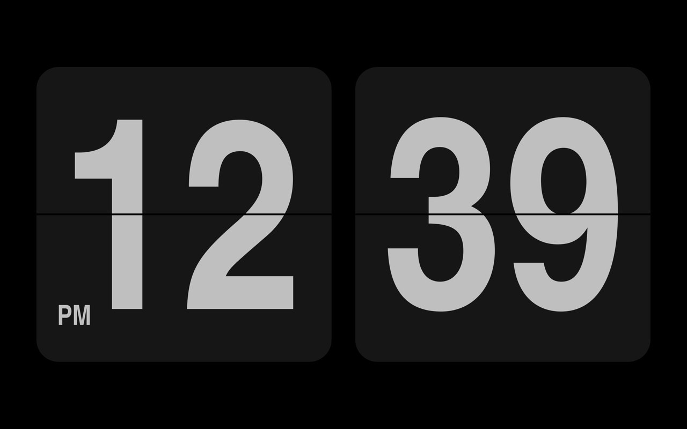
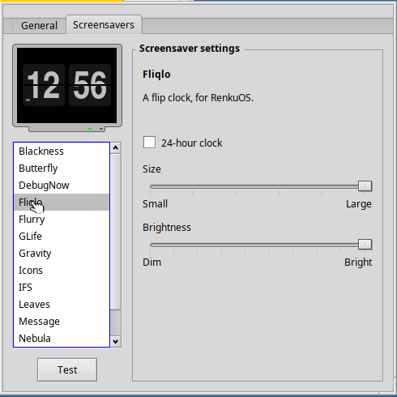
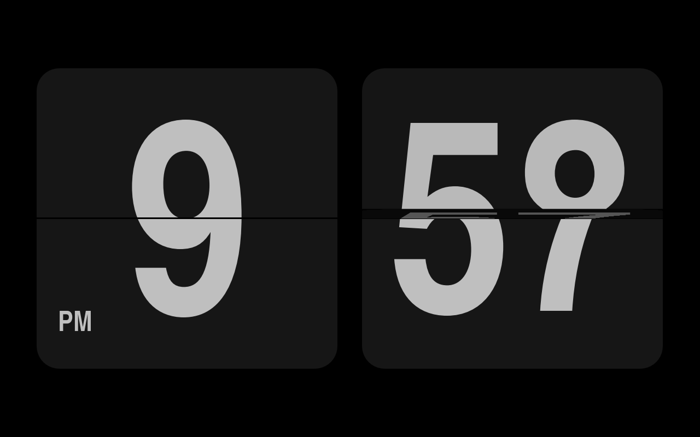

# Fliqlo for RenkuOS

[English](README.md) | [日本語](README.ja.md) | **한국어**

[Fliqlo](https://fliqlo.com/)를 본뜬 Haiku/RenkuOS용 플립 시계 스크린세이버입니다.
검은 바탕에 어두운 카드 두 장이 시와 분을 길쭉하고 굵은 숫자로 보여 주고, 값이
바뀔 때마다 카드 위쪽 절반이 아래로 넘어갑니다. 32비트 x86(x86_gcc2), x86_64,
arm64에서 동작합니다.



## pkgman으로 설치

| Haiku | 저장소 추가 |
| --- | --- |
| 32비트 x86 (x86_gcc2) | `pkgman add-repo https://pkgman.rainygirl.com/x86_gcc2` |
| x86_64 | `pkgman add-repo https://pkgman.rainygirl.com/x86_64` |
| arm64 | `pkgman add-repo http://pkgman.rainygirl.com/arm64` |

```sh
pkgman install fliqlo
```

`pkgman add-repo`가 `Operation not supported`로 실패하면 그 이미지의 네트워크
킷에 TLS가 없는 것입니다. `https://` 대신 `http://`를 사용하세요.

arm64에서는 패키지가 `libscreensaver.so`와 **ScreenSaver** 환경설정도 함께
설치합니다. RENKU arm64 이미지는 최소 빌드라 둘 다 빠져 있습니다.

## 사용법

1. **Deskbar -> Preferences -> ScreenSaver**를 엽니다.
2. 목록에서 **Fliqlo**를 고릅니다. 미리보기에 시계가 나옵니다.
3. 오른쪽에서 옵션을 정합니다.
   - **24-hour clock** -- 끄면 `4 50`과 모서리의 AM/PM, 켜면 `16 50`.
   - **Size** -- 카드가 화면을 차지하는 크기.
   - **Brightness** -- 카드와 숫자의 밝기.
4. **Test**로 전체 화면을 확인합니다. 마우스를 움직이거나 키를 누르면 끝납니다.




Fliqlo의 숫자 폰트는 Helvetica Condensed Bold인데, 이 폰트는 함께 배포할 수 없습니다.
그래서 패키지는 Helvetica를 본뜬 무료 폰트 TeX Gyre Heros Condensed Bold(GUST Font
License)를 설치합니다. 폰트가 없으면 Noto Sans Display Bold로 표시합니다.

## 빌드

Haiku에서 `make install`을 실행하면 애드온을 빌드해 폰트와 함께
`~/config/non-packaged`에 복사합니다. 32비트 x86 하이브리드에서는 기본 `g++`(gcc2)를
쓰세요. 그곳의 screen_blanker는 gcc2 애드온만 로드합니다.

Docker가 있는 작업용 머신에서는 `tools/cross-build.sh all`로 `dist/x86/`(gcc2),
`dist/x86_64/`, `dist/arm64/`를 크로스 빌드합니다. pkgman-repo 레시피가 이것을
패키징합니다.

## 관계 없음

Haiku용으로 따로 구현한 프로그램입니다. Fliqlo 제작사가 만들거나 승인한 것이 아니며
관계도 없습니다. Fliqlo의 코드나 그림은 쓰지 않았습니다.

## AI 고지

Fliqlo for RenkuOS는 AI 코딩 도구(Anthropic의 Claude)의 도움을 받아 개발되었습니다.

## 라이선스

코드는 MIT. `fonts/texgyreheroscn-bold.otf`(TeX Gyre Heros, B. Jackowski,
J. M. Nowacki)는 GUST Font License(`fonts/GUST-FONT-LICENSE.txt`)입니다.
